# 🖋 Audio Scribe
Trascribe speech to audio from multiple files.

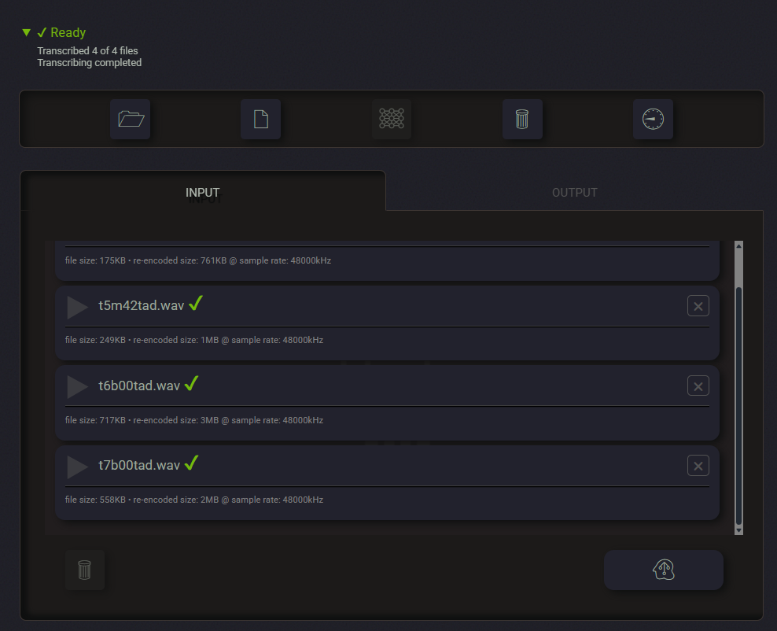

## Features
- Local AI 
- Bulk transcription from multiple audio files
- Extraction of audio files from folders
- Edit and format the resulting text
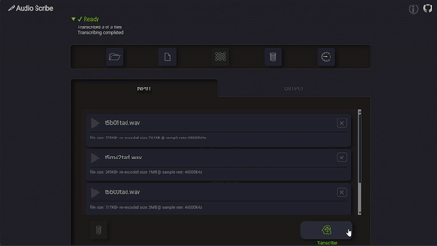

## Quick Start
Use it live here: [https://proc0.github.io/audio-scribe/](https://proc0.github.io/audio-scribe/)

#### Clone and use locally
Requires Node and NPM.

```bash
npm run install
npm run dev
```

#### Build and deploy
```bash
npm run build
npx gh-pages -d dist
```

## Usage

### Load the AI audio model
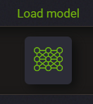

On a new browser session, the AI model is first downloaded, then cached locally. Every other time the app starts on the same browser it will reuse the model from cache if the cache has not been cleared. 

The same load button downloads it first if it's not cached, or uses it from cache.
Once the model loads, a ready message is shown:
<br>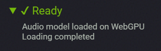

You can clear the cache at any time using this button:
<br>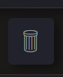

### Select audio files
Select audio files by either dragging and dropping them into the input tab, or using the file or folder picker.

The file picker lets you pick multiple audio files.
<br>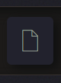

The folder picker lets you pick one or more folders from which audio files will be extracted.
<br>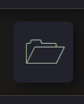

Note that if you open audio files before loading the model, the Transcribe button will be disabled. Don't forget to load the model either before or after adding audio files.
<br>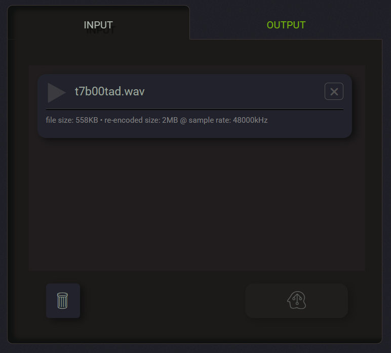

### Transcribe audio
<br>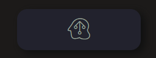

This sends the audio files to the AI model for transcription. Each audio file will show a success or failure. Some audio files can fail if they don't contain any audible speech.

<br>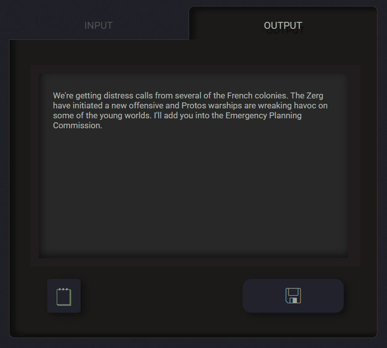

### Adjust settings
Open and close the Settings tab with this button.
<br>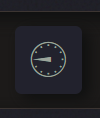

From the settings tab you can choose a name for the output file, and also format the result text for each audio file.
<br>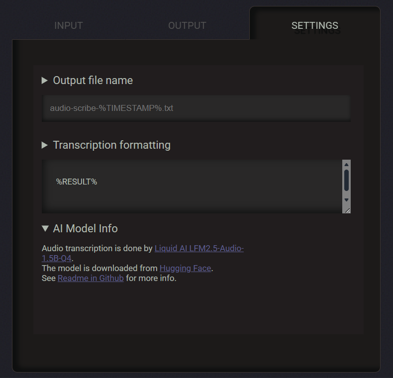

## Technical Details
This uses Liquid AI's [LFM2.5](https://docs.liquid.ai/lfm/models/lfm25-audio-1.5b) quantized version of the audio model. It is downloaded to the client and cached. The uploaded audio files are re-encoded at 48000kHz sample rate and then passed into the model's transcribe API that returns the resulting tokens. It runs completely on the client machine as long as the hardware is fast enough.

The app tests whether WebGPU support is available and falls back to using the CPU instead. For more information on the stats of the AI model see the Liquid AI website in References below. 

## Roadmap
- Use latest model LFM3-Audio

## References
- [Liquid AI](https://www.liquid.ai/)
- [LFM2.5-Audio-1.5B](https://docs.liquid.ai/lfm/models/lfm25-audio-1.5b)
